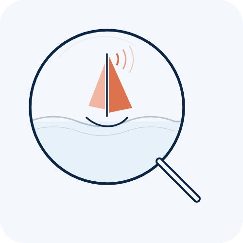

  

<h1 align="center">Shipboard SA</h1>

  <strong>Open-source situational awareness for cruising sailboats</strong> 
  Monitoring · Automation · Maintenance · Passage Planning

---

A complete, open-source system for monitoring and automating a cruising sailboat — built aboard a Hylas 51, published so anyone can fork it and adapt it to their own boat.

Every repository is a working piece of a real ship's automation stack. Together they cover sensor ingest, alarm rules, maintenance tracking, passage planning, anchor watch, and entertainment. The [**guide**](https://github.com/shipboard-sa/guide) is the entry point: hand it to your AI assistant and say *"help me build this on my boat."*

## Repositories

| Layer | Repo | What it does |
|:------|:-----|:-------------|
| **Sense** | [automation-engine](https://github.com/shipboard-sa/automation-engine) | SignalK rules engine — YAML-driven alarm and automation logic, I/O master table, six-layer architecture |
| | [alarm-panel](https://github.com/shipboard-sa/alarm-panel) | Custom 26-channel alarm PCB — NPN LED drivers, backlit labels, mute/test, EasyEDA design files |
| | [wiring-io](https://github.com/shipboard-sa/wiring-io) | Physical wiring documentation — Modbus I/O, relay pool, DIN rail, commissioning checklists |
| **Plan & Operate** | [vessel-ops](https://github.com/shipboard-sa/vessel-ops) | Maintenance, inventory, galley, logbook, cockpit display — FastAPI + React + SQLite |
| | [passage-planner](https://github.com/shipboard-sa/passage-planner) | Weather routing, crew briefings, float plans — CLI pipeline + web interface |
| | [anchor-alarm](https://github.com/shipboard-sa/anchor-alarm) | ESP32-S3 GPS anchor watch — circle-fit algorithm, touchscreen, NMEA 2000 |
| **Quality of Life** | [music-player](https://github.com/shipboard-sa/music-player) | Android shuffle player — Bluetooth auto-connect to boat stereo |
| | [manuals-rag](https://github.com/shipboard-sa/manuals-rag) | Local RAG search over manufacturer PDF manuals |

## Getting Started

1. **Read the [guide](https://github.com/shipboard-sa/guide)** — decision tree, boat survey template, architecture tiers, reference BOM
2. **Pick your tier** — from a single Raspberry Pi monitor to a full automation stack
3. **Fork what you need** — each repo is self-contained with its own README and architecture diagram
4. **Adapt** — swap in your boat's sensors, rename your systems, write rules for your equipment

## Architecture

  

## Design Principles

- **Works with you, never for you** — manual override is always available; automation is advisory
- **Runs offline** — everything works on a local network at sea with no internet
- **Forkable** — MIT licensed, generic configs, example data; clone and make it yours
- **AI-readable** — structured specs designed for an AI assistant to help you build and extend

## License

All repositories are [MIT licensed](https://opensource.org/licenses/MIT).
